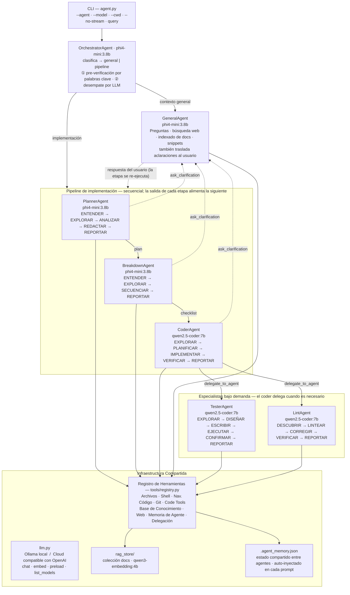

# Code Assistant

Un asistente de código con IA completamente local y sin conexión, impulsado por [Ollama](https://ollama.com). Ejecuta un bucle ReAct multi-agente — un orquestador clasifica cada tarea como una pregunta **general** (respondida por el agente general) o una tarea de **implementación**, que ejecuta a través de un pipeline **planner → breakdown → coder**. Cada agente razona paso a paso y llama a herramientas hasta completar la tarea. Sin APIs externas, sin nube, ningún dato sale de tu máquina.

---

## Tabla de contenidos

1. [Requisitos](#requisitos)
2. [Instalación](#instalación)
3. [Uso](#uso)
4. [Configuración](#configuración)
5. [Arquitectura de agentes](#arquitectura-de-agentes)
6. [RAG de documentación](#rag-de-documentación)
7. [Memoria compartida entre agentes](#memoria-compartida-entre-agentes)
8. [Streaming](#streaming)
9. [BaseAgent — la clase base](#baseagent--la-clase-base)
10. [Referencia de herramientas](#referencia-de-herramientas)
11. [Extender el sistema](#extender-el-sistema)

---

## Requisitos

- Python 3.11+
- [Ollama](https://ollama.com) ejecutándose localmente en `http://localhost:11434`

**Preset A (recomendado, ~7.3 GB de RAM):**
```bash
ollama pull phi4-mini:3.8b      # orquestador, planner, breakdown y agente general
ollama pull qwen2.5-coder:7b    # agentes coder, lint y tester
ollama pull qwen3-embedding:4b  # embeddings para RAG
```

---

## Instalación

```bash
git clone <repo>
cd codeassistant

python3 -m venv .venv
source .venv/bin/activate
pip install -r requirements.txt
```

Precarga los modelos antes del primer uso (elimina la latencia de arranque en frío):

```bash
./preload_models.sh
```

---

## Uso

```bash
# REPL interactivo — el orquestador elige el agente correcto automáticamente
python agent.py

# Consulta de una sola vez
python agent.py "explica qué hace este repositorio"

# Forzar un agente específico
python agent.py --agent coder   "agrega type hints a utils.py"
python agent.py --agent lint    "corrige todos los errores de ruff en src/"
python agent.py --agent planner "planifica cómo agregar soporte OAuth2"
python agent.py --agent general "¿qué es una API REST?"

# Sobreescribir el modelo para todos los agentes (por una sola ejecución)
python agent.py --model qwen2.5-coder:7b "refactoriza main.py"

# Definir el directorio de trabajo inicial
python agent.py --cwd /ruta/a/mi-proyecto "corrige el bug de autenticación"

# Desactivar el streaming (esperar respuesta completa antes de mostrarla)
python agent.py --no-stream "tu tarea"

# Wrapper de conveniencia (usa el .venv automáticamente)
./run.sh "tu tarea"

# Llamar a run.sh desde otra carpeta de proyecto (establece --cwd automáticamente)
/ruta/a/codeassistant/run.sh --cwd /ruta/a/mi-proyecto "corrige el bug de auth"
cd /ruta/a/mi-proyecto && /ruta/a/codeassistant/run.sh "corrige el bug de auth"

# Precargar todos los modelos en memoria de Ollama antes de iniciar
./preload_models.sh           # cargar defaults del Preset A
./preload_models.sh --unload  # liberar todos los modelos

# Listar agentes / modelos disponibles
python agent.py --list-agents
python agent.py --list-models
```

### Variables de entorno

Todos los parámetros pueden configurarse sin tocar el código:

| Variable | Default | Descripción |
|---|---|---|
| `LLM_PROVIDER` | `ollama` | Backend LLM: `ollama` (local) o `cloud` (API compatible con OpenAI) |
| `LLM_BASE_URL` | `https://api.openai.com/v1` | URL base cuando `LLM_PROVIDER=cloud` |
| `LLM_API_KEY` | *(vacío)* | Clave API cuando `LLM_PROVIDER=cloud` |
| `AGENT_MODEL` | `qwen2.5-coder:7b` | Modelo de respaldo global |
| `ORCHESTRATOR_MODEL` | `phi4-mini:3.8b` | Modelo de enrutamiento |
| `CODER_MODEL` | `qwen2.5-coder:7b` | Escritura y edición de código |
| `LINT_MODEL` | `qwen2.5-coder:7b` | Análisis y corrección de lint |
| `PLANNER_MODEL` | `phi4-mini:3.8b` | Planificación de implementación |
| `TESTER_MODEL` | `qwen2.5-coder:7b` | Escritura y ejecución de tests |
| `BREAKDOWN_MODEL` | `phi4-mini:3.8b` | Descomposición de tareas en pasos |
| `GENERAL_MODEL` | `phi4-mini:3.8b` | Preguntas, búsqueda web, indexado de docs |
| `STREAM_OUTPUT` | `true` | Transmitir tokens en tiempo real (`false` para desactivar) |
| `AGENT_MAX_ITER` | `15` | Máximo de iteraciones ReAct por consulta |
| `LLM_TIMEOUT` | `600` | Segundos antes de que expire una llamada LLM (modelos 7b+ necesitan 5-10 min en CPU) |
| `LLM_MAX_TOKENS` | `4096` | Máximo de tokens por generación LLM; limita salidas excesivas |
| `BASH_TIMEOUT` | `60` | Segundos antes de que se cancele un comando de shell |
| `RAG_FETCH_TIMEOUT` | `30` | Segundos antes de que se cancele una descarga de URL (rag_add_url) |
| `OLLAMA_BASE_URL` | `http://localhost:11434` | URL base de la API de Ollama |
| `EMBED_MODEL` | `qwen3-embedding:4b` | Modelo de embeddings para RAG |
| `RAG_CHUNK_SIZE` | `600` | Tamaño de chunk para documentos RAG |
| `RAG_CHUNK_OVERLAP` | `80` | Solapamiento entre chunks adyacentes |

Ejemplo — usar un modelo de coder más grande para una ejecución:
```bash
CODER_MODEL=qwen2.5-coder:7b LLM_TIMEOUT=600 python agent.py --agent coder "reescribe auth.py"
```

---

## Configuración

`config.py` es la fuente de verdad para todos los valores por defecto. Cada valor lee de una variable de entorno con un fallback. Los defaults vienen como **Preset A**, ajustado para 16 GB de RAM / 8 núcleos de CPU:

```python
AGENT_MODELS: dict[str, str] = {
    "orchestrator": os.getenv("ORCHESTRATOR_MODEL", "phi4-mini:3.8b"),
    "coder":        os.getenv("CODER_MODEL",        "qwen2.5-coder:7b"),
    "lint":         os.getenv("LINT_MODEL",         "qwen2.5-coder:7b"),
    "planner":      os.getenv("PLANNER_MODEL",      "phi4-mini:3.8b"),
    "tester":       os.getenv("TESTER_MODEL",       "qwen2.5-coder:7b"),
    "breakdown":    os.getenv("BREAKDOWN_MODEL",    "phi4-mini:3.8b"),
    "general":      os.getenv("GENERAL_MODEL",      "phi4-mini:3.8b"),
}
```

Para cambiar permanentemente la asignación de un modelo, edita el valor de fallback. Para cambiarlo en una sola ejecución, configura la variable de entorno.

### Proveedor cloud (API compatible con OpenAI)

Configura `LLM_PROVIDER=cloud` para enrutar todas las llamadas LLM a cualquier endpoint compatible con OpenAI en lugar de Ollama. Los embeddings siempre permanecen locales vía Ollama.

```bash
LLM_PROVIDER=cloud \
LLM_BASE_URL=https://api.groq.com/openai/v1 \
LLM_API_KEY=sk-... \
CODER_MODEL=llama-3.3-70b-versatile \
python agent.py "refactoriza auth.py"
```

Compatible con Groq, Mistral, Together AI, OpenRouter, vLLM y cualquier otro proveedor compatible con OpenAI. Configura las variables `*_MODEL` de cada agente con los nombres de modelo disponibles en el proveedor objetivo.

---

## Arquitectura de agentes



### Cómo despacha el orquestador

El orquestador primero **clasifica** la petición (una pre-verificación rápida por palabras clave, con respaldo en una llamada LLM de una sola palabra para entradas ambiguas):

- **contexto general** — una pregunta, explicación, recorrido de código, búsqueda web, consulta/indexado de docs, o resumen. Se entrega directamente al agente **general**, que responde.
- **implementación** — cualquier cosa que construya, cambie, refactorice o corrija código. Se ejecuta a través del pipeline de abajo.

### El pipeline de implementación

Para una tarea de implementación el orquestador ejecuta tres agentes **en secuencia**, pasando la salida de cada etapa a la siguiente:

| Etapa | Agente | Produce | Flujo de trabajo |
|---|---|---|---|
| 1 | **planner** | diseño/plan (`plan_*.md`) | ENTENDER → EXPLORAR → ANALIZAR → REDACTAR → REPORTAR |
| 2 | **breakdown** | checklist ordenada (`breakdown_*.md`) | ENTENDER → EXPLORAR → SECUENCIAR → REPORTAR |
| 3 | **coder** | los cambios de código reales | EXPLORAR → PLANIFICAR → IMPLEMENTAR → VERIFICAR → REPORTAR |

El coder recibe tanto el plan como la checklist como contexto, y su reporte es la respuesta final del pipeline.

### El agente general y los especialistas bajo demanda

| Agente | Rol | Flujo de trabajo |
|---|---|---|
| **general** | Preguntas, búsqueda web, resúmenes, indexado de docs; también traslada aclaraciones del pipeline | ReAct abierto con todas las herramientas |
| **tester** | Escritura y ejecución de suites de tests | EXPLORAR → DISEÑAR → ESCRIBIR → EJECUTAR → CONFIRMAR → REPORTAR |
| **lint** | Errores de lint, violaciones de estilo, calidad de código | DESCUBRIR → LINTEAR → CORREGIR → VERIFICAR → REPORTAR |

`tester` y `lint` **no** se enrutan directamente. El coder los alcanza con `delegate_to_agent` cuando una tarea necesita una suite de tests o una pasada de lint:

```json
{
  "thought": "La implementación está lista; necesito una suite de tests para ella",
  "action": "delegate_to_agent",
  "action_input": {
    "agent": "tester",
    "task": "Escribe y ejecuta tests con pytest para el nuevo limitador de tasa en limiter.py."
  }
}
```

La delegación está limitada a un nivel de profundidad para evitar cadenas recursivas.

### Aclaración a mitad del pipeline

Si cualquier etapa del pipeline se bloquea por una decisión que solo el usuario puede tomar, emite una acción `ask_clarification` en lugar de adivinar:

```json
{
  "action": "ask_clarification",
  "action_input": { "question": "¿La caché debe ser por usuario o global?" }
}
```

El pipeline se pausa, el agente general traslada la pregunta al usuario, y la respuesta se pasa de vuelta para que la etapa se re-ejecute con la nueva información (limitado a dos rondas de aclaración por etapa).

### CoderAgent — flujo de 5 fases

| Fase | Qué ocurre | Herramientas clave |
|---|---|---|
| 1. Explorar | Revisión de solo lectura; consulta `rag_search(collection="docs")` para docs de librerías | `find_files`, `code_outline`, `grep_code`, `rag_search` |
| 2. Planificar | Emite una acción `plan` — lista pasos, archivos a crear/modificar | *(acción especial)* |
| 3. Implementar | Escribe y edita archivos; lintea después de cada archivo | `write_file`, `edit_file`, `bash` |
| 4. Verificar | Lintea cada archivo modificado; ejecuta tests si existen | `lint`, `run_tests` |
| 5. Reportar | `final_answer` estructurado con resumen | *(final_answer)* |

### LintAgent — flujo de 5 fases

| Fase | Qué ocurre |
|---|---|
| 1. Descubrir | Encontrar archivos/dirs a lintear; enfocarse en archivos cambiados en git |
| 2. Lintear | Ejecutar el linter en cada objetivo; recopilar todos los problemas antes de tocar nada |
| 3. Corregir | `edit_file` por línea marcada; `fix_code` para problemas complejos; errores primero |
| 4. Verificar | Re-lintear cada archivo tocado; debe estar libre de errores antes de reportar |
| 5. Reportar | Conteo de problemas por archivo, cada corrección realizada, advertencias restantes |

---

## RAG de documentación

La colección RAG `docs` es una base de conocimiento compartida mantenida por el **agente general** y consultada automáticamente por coder, lint y planner durante sus fases de exploración.

### Indexar documentación

```bash
# Se enruta automáticamente al agente general
python agent.py "actualiza los docs de la librería httpx"
python agent.py "indexa la documentación de FastAPI — primeros pasos y referencia de API"
python agent.py "refresca el changelog de numpy"
```

El agente general:
1. Busca la URL de documentación oficial
2. Ingiere páginas clave en `collection="docs"` con `rag_add_url` (re-ingerir actualiza automáticamente)
3. Reporta qué fue indexado y el conteo de chunks

### Usar los docs indexados en tareas de código

Una vez indexados, cualquier tarea de código que involucre esas librerías se beneficia automáticamente:

```bash
python agent.py "implementa un wrapper de reintentos usando httpx"
# → la fase EXPLORAR del coder consulta rag_search("httpx retry", collection="docs")
# → encuentra los docs de API relevantes y los usa en la implementación
```

### Consulta manual

```bash
python agent.py --agent general "busca en la colección docs la configuración de timeout de httpx"
```

---

## Memoria compartida entre agentes

Cuando varios agentes colaboran en una tarea — el orquestador delega en un coder, que a su vez delega en un tester — necesitan compartir contexto sin repetirlo en cada prompt. Para eso existe la **memoria compartida entre agentes**.

Es un único archivo JSON, `.agent_memory.json`, escrito en el directorio de trabajo (`cwd`). Cada agente puede leerlo y actualizarlo mediante dos herramientas:

| Herramienta | Parámetros | Descripción |
|---|---|---|
| `memory_read` | `key?` | Leer toda la memoria, o una sola clave |
| `memory_write` | `key`, `value` | Establecer o actualizar una clave. Para claves con valor de lista, pasar un string **agrega** (sin duplicados) en lugar de sobrescribir |

### Cómo se usa

- **Se inyecta automáticamente en cada prompt.** Al inicio de cada ejecución, `BaseAgent._system_prompt_with_memory()` (en `agents/base.py`) añade la memoria actual como un bloque JSON al system prompt del agente, de modo que un agente recupera el contexto previo automáticamente — sin necesidad de una lectura explícita.
- **Las claves conocidas** se muestran primero, en este orden: `project`, `files_created`, `files_modified`, `decisions`, `completed`, `pending`, `notes`. Cualquier clave adicional se añade después.
- **Sobrevive entre turnos y delegaciones** porque vive en disco en el directorio del proyecto. Elimina `.agent_memory.json` para reiniciarla.

```jsonc
// .agent_memory.json — ejemplo
{
  "project": "Agregar login OAuth2 a la API de Flask",
  "files_created": ["auth/oauth.py"],
  "files_modified": ["app.py", "requirements.txt"],
  "decisions": ["Usar Authlib para el cliente OAuth2"],
  "completed": ["Conectadas las rutas /login y /callback"],
  "pending": ["Escribir tests para el manejador de callback"]
}
```

> Nota: `.agent_memory.json` es estado de ejecución por proyecto y no se rastrea en git.

---

## Streaming

La salida del LLM se transmite token por token en modo REPL y de una sola vez por defecto.

- **Terminal con Rich**: un panel `Live(transient=True)` se llena mientras llegan los tokens, luego desaparece — reemplazado por el panel formateado de llamada a herramienta o respuesta. Sin desorden.
- **Terminal plana**: los tokens se imprimen en línea con flush, seguidos de un salto de línea.
- `STREAM_OUTPUT=false` o `--no-stream` para desactivar globalmente o por ejecución.

```bash
python agent.py --no-stream "tu tarea"    # esperar respuesta completa
STREAM_OUTPUT=false ./run.sh              # desactivar globalmente
```

---

## BaseAgent — la clase base

`agents/base.py` define `BaseAgent`, del que heredan todos los agentes.

### Constructor

```python
def __init__(self, model: str = None, cwd: str = None, _depth: int = 0, streaming: bool = None):
    self._model_override = model   # None = usar config AGENT_MODELS del agente
    self.model = ...               # nombre de modelo resuelto
    self.cwd = cwd or os.getcwd()
    self._depth = _depth           # profundidad de delegación — máximo 1
    self._streaming = ...          # desde config STREAM_OUTPUT o override explícito
```

### Interfaz abstracta

```python
def build_system_prompt(self) -> str: ...                              # obligatorio

def handle_special_action(self, action, action_input) -> str | None:  # opcional
```

`BaseAgent.handle_special_action` maneja `delegate_to_agent`. `CoderAgent` lo sobreescribe para manejar `plan` y llama a `super()` para todo lo demás.

### Bucle ReAct

```
run(user_input)
│
├── Construir mensajes: [system_prompt (+ memoria compartida), user_message]
│
└── para cada iteración (hasta MAX_ITERATIONS):
    │
    ├── _call_llm(messages) → string crudo
    │   ├── streaming=True:  panel Rich Live se llena token a token, luego desaparece
    │   └── streaming=False: bloquea hasta respuesta completa
    │
    ├── _extract_action(raw) → dict o None
    │
    ├── si None: inyectar corrección JSON (hasta 2 reintentos) o tratar como respuesta final
    │
    ├── si action == "final_answer": mostrar + retornar
    │
    ├── handle_special_action → observación o None
    │
    └── execute_tool → (resultado, new_cwd) → agregar Observación → continuar
```

---

## Referencia de herramientas

### Operaciones de archivos
| Herramienta | Parámetros | Descripción |
|---|---|---|
| `read_file` | `path` | Leer contenido completo del archivo |
| `read_lines` | `path`, `start?`, `end?` | Leer un rango de líneas (índice desde 1) |
| `write_file` | `path`, `content` | Escribir o sobreescribir un archivo |
| `edit_file` | `path`, `old_text`, `new_text` | Reemplazar la primera ocurrencia de `old_text` |
| `list_dir` | `path?` | Listar entradas del directorio |
| `make_dir` | `path` | Crear directorio (y padres); no hace nada si ya existe |
| `remove_dir` | `path`, `recursive?` | Eliminar directorio |
| `change_dir` | `path` | Cambiar cwd (persiste durante el resto de la ejecución) |

### Shell
| Herramienta | Parámetros | Descripción |
|---|---|---|
| `bash` | `command`, `timeout?` | Ejecutar comando de shell; cwd persiste; comandos peligrosos bloqueados |

### Navegación de código
| Herramienta | Parámetros | Descripción |
|---|---|---|
| `grep_code` | `pattern`, `path?`, `file_glob?`, `case_sensitive?`, `max_matches?` | Búsqueda regex en archivos fuente |
| `find_files` | `pattern`, `path?`, `max_results?` | Búsqueda glob de nombres de archivo |
| `code_outline` | `path` | Extraer clases, funciones, imports (AST para Python, regex para JS/TS) |

### Git
| Herramienta | Parámetros | Descripción |
|---|---|---|
| `git_status` | — | Estado del árbol de trabajo |
| `git_diff` | `path?`, `staged?` | Mostrar cambios sin stage o staged |
| `git_log` | `n?` | Historial reciente de commits |
| `git_commit` | `message`, `files?` | Stage y commit |
| `git_branch` | — | Listar ramas |
| `git_checkout` | `ref`, `create?` | Cambiar o crear rama |
| `git_blame` | `path` | Autoría por línea |

### Herramientas de código con LLM
| Herramienta | Parámetros | Descripción |
|---|---|---|
| `explain_code` | `code`, `language?` | Explicación en lenguaje natural |
| `fix_code` | `code`, `error`, `language?` | Causa raíz + código corregido |
| `generate_tests` | `code`, `language?`, `framework?` | Generación de tests unitarios |
| `review_code` | `code`, `language?` | Bugs, seguridad, rendimiento, estilo |
| `lint` | `path` | ruff → flake8 → pylint (Python); eslint (JS/TS); fallback AST |
| `run_tests` | `path?`, `pattern?`, `verbose?` | pytest o unittest |

### Base de conocimiento
| Herramienta | Parámetros | Descripción |
|---|---|---|
| `save_snippet` | `name`, `code`, `language?`, `description?` | Guardar un snippet de código reutilizable |
| `get_snippet` | `name` | Recuperar un snippet por nombre |
| `list_snippets` | — | Listar todos los snippets |
| `delete_snippet` | `name` | Eliminar un snippet |
| `rag_add_text` | `name`, `text`, `collection?` | Ingerir texto en el store RAG |
| `rag_add_file` | `path`, `collection?` | Ingerir un archivo |
| `rag_add_url` | `url`, `collection?` | Obtener e ingerir una página web (idempotente — re-ingerir actualiza) |
| `rag_search` | `query`, `collection?`, `top_k?` | Búsqueda semántica |
| `rag_list` | `collection?` | Listar documentos ingeridos |
| `rag_collections` | — | Listar todas las colecciones |
| `rag_delete` | `source`, `collection?` | Eliminar un documento |

### Memoria compartida entre agentes
| Herramienta | Parámetros | Descripción |
|---|---|---|
| `memory_read` | `key?` | Leer el `.agent_memory.json` compartido — memoria completa o una clave |
| `memory_write` | `key`, `value` | Establecer/actualizar una clave; los strings se agregan a claves de lista |

### Delegación de agentes
| Herramienta | Parámetros | Descripción |
|---|---|---|
| `delegate_to_agent` | `agent`, `task` | Delegar una subtarea a un agente especialista |

### Web
| Herramienta | Parámetros | Descripción |
|---|---|---|
| `websearch` | `query`, `max_results?` | Búsqueda en DuckDuckGo |
| `summarize` | `text`, `focus?` | Resumen con LLM |

---

## Extender el sistema

### Agregar un nuevo agente

1. Crear `agents/miagente.py` heredando de `BaseAgent`
2. Registrar en el `REGISTRY` de `agents/__init__.py`
3. Agregar entrada de modelo en `AGENT_MODELS` de `config.py`
4. Agregar descripción de enrutamiento en `_AGENT_DESCRIPTIONS` de `agents/orchestrator.py`
5. Opcionalmente agregar señales de palabras clave en `_keyword_route` de `agents/orchestrator.py`

### Agregar una nueva herramienta

1. Implementar la función en `tools/*.py` devolviendo un string
2. Agregar dict de definición a `TOOLS` en `tools/registry.py`
3. Agregar caso `elif` en `execute_tool()` de `tools/registry.py`

La herramienta aparece automáticamente en el output de `_tool_docs()` de todos los agentes.

### Agregar una acción especial

Sobreescribir `handle_special_action` en tu agente:

```python
def handle_special_action(self, action: str, action_input: dict) -> str | None:
    if action == "mi_accion":
        return "Observation: acción completada"
    return super().handle_special_action(action, action_input)  # siempre propagar
```

### Estructura del proyecto

```
codeassistant/
├── agent.py              # Punto de entrada CLI (argparse)
├── llm.py                # Cliente HTTP de Ollama (chat + embed + preload)
├── config.py             # Todos los tunables — vars de entorno con defaults (Preset A)
├── run.sh                # Wrapper de conveniencia (usa .venv)
├── preload_models.sh     # Precarga paralela de modelos; muestra uso de RAM; flag --unload
│
├── agents/
│   ├── __init__.py       # Dict REGISTRY + DEFAULT_AGENT
│   ├── base.py           # BaseAgent: bucle ReAct, streaming, display, delegación
│   ├── orchestrator.py   # Enruta por pre-verificación de keywords + llamada LLM
│   ├── planner.py        # Planificación de solo lectura; guarda plan_*.md
│   ├── coder.py          # Flujo de codificación en 5 fases
│   ├── lint.py           # Flujo de lint/corrección en 5 fases
│   ├── tester.py         # Escritura, ejecución y confirmación de tests
│   ├── breakdown.py      # Descomposición de tareas en pasos ordenados
│   └── general.py        # Q&A abierto, indexado de docs, búsqueda web
│
├── tools/
│   ├── registry.py       # Lista TOOLS + dispatcher execute_tool
│   ├── file_ops.py       # leer/escribir/editar/listar/crear/eliminar archivos
│   ├── bash_exec.py      # Ejecución segura de shell con seguimiento de cwd
│   ├── code_nav.py       # grep, find, outline, read_lines
│   ├── git_ops.py        # git status/diff/log/commit/branch/…
│   ├── code_tools.py     # lint, run_tests, explain/fix/generate/review
│   ├── websearch.py      # Búsqueda DuckDuckGo via ddgs
│   ├── summarize.py      # Resumen de texto con LLM
│   ├── snippets.py       # Store persistente de snippets de código
│   ├── rag.py            # RAG: chunk, embed (numpy), búsqueda coseno
│   └── agent_memory.py   # Lectura/escritura del .agent_memory.json compartido
│
├── snippets/             # Archivos de snippets guardados (creados en runtime)
├── rag_store/            # Store vectorial RAG — colección "docs" para docs de librerías
└── .agent_memory.json    # Memoria compartida por proyecto (creada en runtime, sin rastrear)
```
