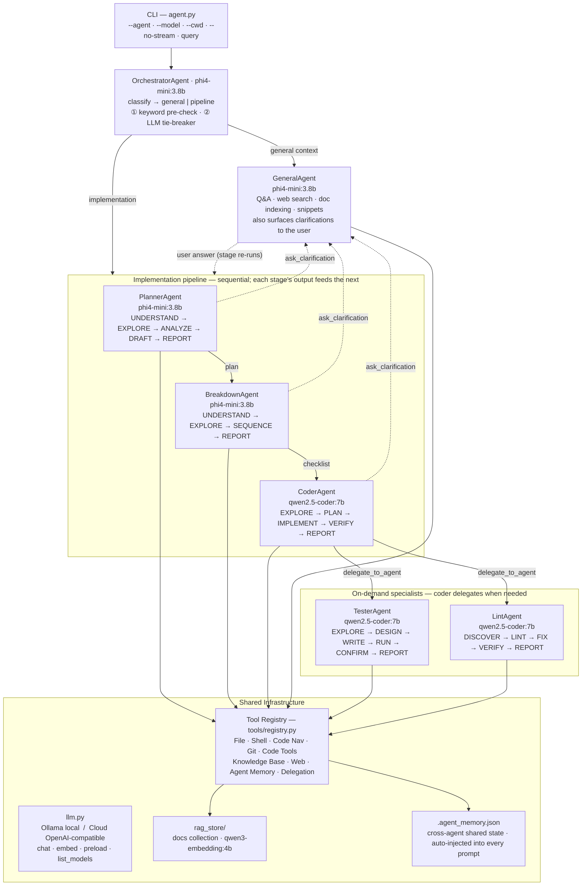

# Code Assistant

A local, fully offline AI code assistant powered by [Ollama](https://ollama.com). It runs a multi-agent ReAct loop — an orchestrator classifies each task as either a **general** question (answered by the general agent) or an **implementation** task, which it runs through a **planner → breakdown → coder** pipeline. Each agent reasons step-by-step and calls tools until the task is complete. No external APIs, no cloud, no data leaves your machine.

---

## Table of Contents

1. [Requirements](#requirements)
2. [Installation](#installation)
3. [Usage](#usage)
4. [Configuration](#configuration)
5. [Agent Architecture](#agent-architecture)
6. [Documentation RAG](#documentation-rag)
7. [Shared agent memory](#shared-agent-memory)
8. [Streaming](#streaming)
9. [BaseAgent — the parent class](#baseagent--the-parent-class)
10. [Tools reference](#tools-reference)
11. [Extending the codebase](#extending-the-codebase)

---

## Requirements

- Python 3.11+
- [Ollama](https://ollama.com) running locally on `http://localhost:11434`

**Preset A (recommended, ~7.3 GB RAM):**
```bash
ollama pull phi4-mini:3.8b      # orchestrator, planner, breakdown + general agents
ollama pull qwen2.5-coder:7b    # coder, lint + tester agents
ollama pull qwen3-embedding:4b  # RAG embeddings
```

---

## Installation

```bash
git clone <repo>
cd codeassistant

python3 -m venv .venv
source .venv/bin/activate
pip install -r requirements.txt
```

Warm up all models before the first run (eliminates cold-start latency):

```bash
./preload_models.sh
```

---

## Usage

```bash
# Interactive REPL — orchestrator picks the right agent automatically
python agent.py

# Single-shot query
python agent.py "explain what this repo does"

# Force a specific agent
python agent.py --agent coder   "add type hints to utils.py"
python agent.py --agent lint    "fix all ruff errors in src/"
python agent.py --agent planner "plan how to add OAuth2 support"
python agent.py --agent general "what is a REST API?"

# Override the model for all agents (one-off)
python agent.py --model qwen2.5-coder:7b "refactor main.py"

# Set the working directory the agent starts in
python agent.py --cwd /path/to/myproject "fix the auth bug"

# Disable streaming (wait for full response before display)
python agent.py --no-stream "your task"

# Convenience wrapper (uses the venv automatically)
./run.sh "your task"

# Call run.sh from a different project folder (sets --cwd automatically)
/path/to/codeassistant/run.sh --cwd /path/to/my-project "fix the auth bug"
cd /path/to/my-project && /path/to/codeassistant/run.sh "fix the auth bug"

# Warm up all models into Ollama memory before starting
./preload_models.sh           # load Preset A defaults
./preload_models.sh --unload  # release all models

# List available agents / models
python agent.py --list-agents
python agent.py --list-models
```

### Environment variable overrides

All tunables can be set without touching code:

| Variable | Default | Description |
|---|---|---|
| `LLM_PROVIDER` | `ollama` | LLM backend: `ollama` (local) or `cloud` (OpenAI-compatible API) |
| `LLM_BASE_URL` | `https://api.openai.com/v1` | Base URL when `LLM_PROVIDER=cloud` |
| `LLM_API_KEY` | *(empty)* | API key when `LLM_PROVIDER=cloud` |
| `AGENT_MODEL` | `qwen2.5-coder:7b` | Global fallback model |
| `ORCHESTRATOR_MODEL` | `phi4-mini:3.8b` | Routing model |
| `CODER_MODEL` | `qwen2.5-coder:7b` | Code writing and editing |
| `LINT_MODEL` | `qwen2.5-coder:7b` | Lint analysis and fixing |
| `PLANNER_MODEL` | `phi4-mini:3.8b` | Implementation planning |
| `TESTER_MODEL` | `qwen2.5-coder:7b` | Test writing and execution |
| `BREAKDOWN_MODEL` | `phi4-mini:3.8b` | Task decomposition into steps |
| `GENERAL_MODEL` | `phi4-mini:3.8b` | Q&A, web search, doc indexing |
| `STREAM_OUTPUT` | `true` | Stream tokens in real time (`false` to disable) |
| `AGENT_MAX_ITER` | `15` | Max ReAct iterations per query |
| `LLM_TIMEOUT` | `600` | Seconds before an LLM call times out (7b+ models need 5-10 min on CPU) |
| `LLM_MAX_TOKENS` | `4096` | Max tokens per LLM generation; caps runaway output |
| `BASH_TIMEOUT` | `60` | Seconds before a shell command is killed |
| `RAG_FETCH_TIMEOUT` | `30` | Seconds before a URL fetch (rag_add_url) is aborted |
| `OLLAMA_BASE_URL` | `http://localhost:11434` | Ollama API base URL |
| `EMBED_MODEL` | `qwen3-embedding:4b` | Embedding model for RAG |
| `RAG_CHUNK_SIZE` | `600` | Token size for RAG document chunks |
| `RAG_CHUNK_OVERLAP` | `80` | Overlap between adjacent chunks |

Example — use a larger coder model for one run:
```bash
CODER_MODEL=qwen2.5-coder:7b LLM_TIMEOUT=600 python agent.py --agent coder "rewrite auth.py"
```

---

## Configuration

`config.py` is the single source of truth for all defaults. Every value reads from an environment variable with a fallback. The defaults ship as **Preset A**, tuned for 16 GB RAM / 8 CPU cores:

```python
AGENT_MODELS: dict[str, str] = {
    "orchestrator": os.getenv("ORCHESTRATOR_MODEL", "phi4-mini:3.8b"),
    "coder":        os.getenv("CODER_MODEL",        "qwen2.5-coder:7b"),
    "lint":         os.getenv("LINT_MODEL",         "qwen2.5-coder:7b"),
    "planner":      os.getenv("PLANNER_MODEL",      "phi4-mini:3.8b"),
    "tester":       os.getenv("TESTER_MODEL",       "qwen2.5-coder:7b"),
    "breakdown":    os.getenv("BREAKDOWN_MODEL",    "phi4-mini:3.8b"),
    "general":      os.getenv("GENERAL_MODEL",      "phi4-mini:3.8b"),
}
```

To permanently change a model assignment, edit the fallback string. To change it for a single run, set the env var.

### Cloud provider (OpenAI-compatible API)

Set `LLM_PROVIDER=cloud` to route all LLM calls to any OpenAI-compatible endpoint instead of Ollama. Embeddings always stay local via Ollama.

```bash
LLM_PROVIDER=cloud \
LLM_BASE_URL=https://api.groq.com/openai/v1 \
LLM_API_KEY=sk-... \
CODER_MODEL=llama-3.3-70b-versatile \
python agent.py "refactor auth.py"
```

Compatible with Groq, Mistral, Together AI, OpenRouter, vLLM, and any other OpenAI-compatible provider. Set the per-agent `*_MODEL` env vars to model names available on the target provider.

---

## Agent Architecture



### How the orchestrator dispatches

The orchestrator first **classifies** the request (a fast keyword pre-check, falling back to a one-word LLM call for ambiguous input):

- **general context** — a question, explanation, code walkthrough, web search, doc lookup/indexing, or summary. Handed straight to the **general** agent, which responds.
- **implementation** — anything that builds, changes, refactors, or fixes code. Run through the pipeline below.

### The implementation pipeline

For an implementation task the orchestrator runs three agents **in sequence**, threading each stage's output into the next:

| Stage | Agent | Produces | Workflow |
|---|---|---|---|
| 1 | **planner** | design/plan (`plan_*.md`) | UNDERSTAND → EXPLORE → ANALYZE → DRAFT → REPORT |
| 2 | **breakdown** | ordered checklist (`breakdown_*.md`) | UNDERSTAND → EXPLORE → SEQUENCE → REPORT |
| 3 | **coder** | the actual code changes | EXPLORE → PLAN → IMPLEMENT → VERIFY → REPORT |

The coder receives both the plan and the breakdown as context, and its report is the pipeline's final answer.

### The general agent and on-demand specialists

| Agent | Role | Workflow |
|---|---|---|
| **general** | Q&A, web search, summaries, doc indexing; also surfaces pipeline clarifications | Open-ended ReAct with all tools |
| **tester** | Writing and running test suites | EXPLORE → DESIGN → WRITE → RUN → CONFIRM → REPORT |
| **lint** | Lint errors, style violations, code quality | DISCOVER → LINT → FIX → VERIFY → REPORT |

`tester` and `lint` are **not** routed to directly. The coder reaches them with `delegate_to_agent` when a task needs a test suite or a lint pass:

```json
{
  "thought": "The implementation is done; I need a test suite for it",
  "action": "delegate_to_agent",
  "action_input": {
    "agent": "tester",
    "task": "Write and run pytest tests for the new rate limiter in limiter.py."
  }
}
```

Delegation is limited to one level deep to prevent recursive chains.

### Mid-pipeline clarification

If any pipeline stage is blocked by a decision only the user can make, it emits an `ask_clarification` action instead of guessing:

```json
{
  "action": "ask_clarification",
  "action_input": { "question": "Should the cache be per-user or global?" }
}
```

The pipeline pauses, the general agent surfaces the question to the user, and the answer is threaded back so the stage re-runs with the new information (capped at two clarification rounds per stage).

### CoderAgent — 5-phase workflow

| Phase | What happens | Key tools |
|---|---|---|
| 1. Explore | Read-only survey; queries `rag_search(collection="docs")` for library docs | `find_files`, `code_outline`, `grep_code`, `rag_search` |
| 2. Plan | Emits a `plan` action — lists steps, files to create/modify | *(special action)* |
| 3. Implement | Writes and edits files; lints after each file | `write_file`, `edit_file`, `bash` |
| 4. Verify | Lints every changed file, runs tests if present | `lint`, `run_tests` |
| 5. Report | Structured `final_answer` with summary | *(final_answer)* |

### LintAgent — 5-phase workflow

| Phase | What happens |
|---|---|
| 1. Discover | Find files/dirs to lint; focus on git-changed files when scoped |
| 2. Lint | Run linter on every target; collect all issues before touching anything |
| 3. Fix | `edit_file` per flagged line; `fix_code` for complex issues; errors first |
| 4. Verify | Re-lint every touched file; must be error-free before reporting |
| 5. Report | Per-file issue counts, each fix made, remaining acceptable warnings |

---

## Documentation RAG

The `docs` RAG collection is a shared knowledge base maintained by the **general agent** and queried automatically by coder, lint, and planner during their EXPLORE phases.

### Indexing documentation

```bash
# Auto-routed to the general agent
python agent.py "update docs for the httpx library"
python agent.py "index the FastAPI documentation — getting started and API reference"
python agent.py "refresh the numpy changelog"
```

The general agent will:
1. Search for the official documentation URL
2. Ingest key pages into `collection="docs"` with `rag_add_url` (re-ingesting auto-refreshes)
3. Report what was indexed and the chunk count

### Using indexed docs in code tasks

Once indexed, any coding task involving those libraries automatically benefits:

```bash
python agent.py "implement a retry wrapper using httpx"
# → coder EXPLORE phase queries rag_search("httpx retry", collection="docs")
# → finds the relevant API docs and uses them in the implementation
```

### Querying manually

```bash
python agent.py --agent general "search the docs collection for httpx timeout configuration"
```

---

## Shared agent memory

When several agents collaborate on a task — the orchestrator delegating to a coder, which delegates to a tester — they need a way to share context without repeating it in every prompt. That is what the **shared agent memory** provides.

It is a single JSON file, `.agent_memory.json`, written to the working directory (`cwd`). Every agent can read and update it via two tools:

| Tool | Parameters | Description |
|---|---|---|
| `memory_read` | `key?` | Read the whole memory, or a single key |
| `memory_write` | `key`, `value` | Set or update a key. For list-valued keys, passing a string **appends** (deduplicated) rather than overwriting |

### How it is used

- **Auto-injected into every prompt.** At the start of each run, `BaseAgent._system_prompt_with_memory()` (in `agents/base.py`) appends the current memory as a JSON block to the agent's system prompt, so an agent picks up prior context automatically — no explicit read needed.
- **Well-known keys** are rendered first, in this order: `project`, `files_created`, `files_modified`, `decisions`, `completed`, `pending`, `notes`. Any additional keys are appended after them.
- **Survives across turns and delegations** because it lives on disk in the project directory. Delete `.agent_memory.json` to reset it.

```jsonc
// .agent_memory.json — example
{
  "project": "Add OAuth2 login to the Flask API",
  "files_created": ["auth/oauth.py"],
  "files_modified": ["app.py", "requirements.txt"],
  "decisions": ["Use Authlib for the OAuth2 client"],
  "completed": ["Wired the /login and /callback routes"],
  "pending": ["Write tests for the callback handler"]
}
```

> Note: `.agent_memory.json` is per-project runtime state and is not tracked in git.

---

## Streaming

LLM output streams token by token in both REPL and single-shot modes by default.

- **Rich terminal**: a `Live(transient=True)` panel fills as tokens arrive, then disappears — replaced by the formatted tool call or answer panel. No clutter.
- **Plain terminal**: tokens print inline with flush, followed by a newline.
- `STREAM_OUTPUT=false` or `--no-stream` to disable globally or per-run.

```bash
python agent.py --no-stream "your task"       # wait for full response
STREAM_OUTPUT=false ./run.sh                  # disable globally
```

---

## BaseAgent — the parent class

`agents/base.py` defines `BaseAgent`, which all agents inherit from.

### Constructor

```python
def __init__(self, model: str = None, cwd: str = None, _depth: int = 0, streaming: bool = None):
    self._model_override = model   # None = use per-agent AGENT_MODELS config
    self.model = ...               # resolved model name
    self.cwd = cwd or os.getcwd()
    self._depth = _depth           # delegation depth — max 1
    self._streaming = ...          # from STREAM_OUTPUT config or explicit override
```

### Abstract interface

```python
def build_system_prompt(self) -> str: ...          # required

def handle_special_action(self, action, action_input) -> str | None: ...  # optional
```

`BaseAgent.handle_special_action` handles `delegate_to_agent`. `CoderAgent` overrides it to handle `plan`, then calls `super()` for everything else.

### ReAct loop

```
run(user_input)
│
├── Build messages: [system_prompt (+ shared agent memory), user_message]
│
└── for each iteration (up to MAX_ITERATIONS):
    │
    ├── _call_llm(messages) → raw string
    │   ├── streaming=True:  Rich Live panel fills token-by-token, then vanishes
    │   └── streaming=False: blocks until full response
    │
    ├── _extract_action(raw) → dict or None
    │
    ├── if None: inject JSON correction (up to 2 retries) or treat as final answer
    │
    ├── if action == "final_answer": display + return
    │
    ├── handle_special_action → observation or None
    │
    └── execute_tool → (result, new_cwd) → append Observation → continue
```

---

## Tools reference

### File operations
| Tool | Parameters | Description |
|---|---|---|
| `read_file` | `path` | Read full file contents |
| `read_lines` | `path`, `start?`, `end?` | Read a line range (1-indexed) |
| `write_file` | `path`, `content` | Write or overwrite a file |
| `edit_file` | `path`, `old_text`, `new_text` | Replace the first occurrence of `old_text` |
| `list_dir` | `path?` | List directory entries |
| `make_dir` | `path` | Create directory (and parents); no-op if exists |
| `remove_dir` | `path`, `recursive?` | Remove directory |
| `change_dir` | `path` | Change cwd (persists for the rest of the run) |

### Shell
| Tool | Parameters | Description |
|---|---|---|
| `bash` | `command`, `timeout?` | Run a shell command; cwd persists; dangerous commands blocked |

### Code navigation
| Tool | Parameters | Description |
|---|---|---|
| `grep_code` | `pattern`, `path?`, `file_glob?`, `case_sensitive?`, `max_matches?` | Regex search across source files |
| `find_files` | `pattern`, `path?`, `max_results?` | Glob search for filenames |
| `code_outline` | `path` | Extract classes, functions, imports (AST for Python, regex for JS/TS) |

### Git
| Tool | Parameters | Description |
|---|---|---|
| `git_status` | — | Working tree status |
| `git_diff` | `path?`, `staged?` | Show unstaged or staged changes |
| `git_log` | `n?` | Recent commit history |
| `git_commit` | `message`, `files?` | Stage and commit |
| `git_branch` | — | List branches |
| `git_checkout` | `ref`, `create?` | Switch or create branch |
| `git_blame` | `path` | Per-line authorship |

### LLM-powered code tools
| Tool | Parameters | Description |
|---|---|---|
| `explain_code` | `code`, `language?` | Plain-English explanation |
| `fix_code` | `code`, `error`, `language?` | Root cause + corrected code |
| `generate_tests` | `code`, `language?`, `framework?` | Unit test generation |
| `review_code` | `code`, `language?` | Bugs, security, performance, style |
| `lint` | `path` | ruff → flake8 → pylint (Python); eslint (JS/TS); AST fallback |
| `run_tests` | `path?`, `pattern?`, `verbose?` | pytest or unittest |

### Knowledge base
| Tool | Parameters | Description |
|---|---|---|
| `save_snippet` | `name`, `code`, `language?`, `description?` | Save a reusable code snippet |
| `get_snippet` | `name` | Retrieve a snippet by name |
| `list_snippets` | — | List all snippets |
| `delete_snippet` | `name` | Remove a snippet |
| `rag_add_text` | `name`, `text`, `collection?` | Ingest raw text into the RAG store |
| `rag_add_file` | `path`, `collection?` | Ingest a file |
| `rag_add_url` | `url`, `collection?` | Fetch and ingest a web page (idempotent — re-ingesting refreshes) |
| `rag_search` | `query`, `collection?`, `top_k?` | Semantic search |
| `rag_list` | `collection?` | List ingested documents |
| `rag_collections` | — | List all collections |
| `rag_delete` | `source`, `collection?` | Remove a document |

### Shared agent memory
| Tool | Parameters | Description |
|---|---|---|
| `memory_read` | `key?` | Read the shared `.agent_memory.json` — full memory or one key |
| `memory_write` | `key`, `value` | Set/update a key; strings append to list-valued keys |

### Agent delegation
| Tool | Parameters | Description |
|---|---|---|
| `delegate_to_agent` | `agent`, `task` | Hand off a sub-task to a specialist agent |

### Web
| Tool | Parameters | Description |
|---|---|---|
| `websearch` | `query`, `max_results?` | DuckDuckGo search |
| `summarize` | `text`, `focus?` | LLM-powered summarization |

---

## Extending the codebase

### Add a new agent

1. Create `agents/myagent.py` inheriting from `BaseAgent`
2. Register in `agents/__init__.py` REGISTRY
3. Add model entry to `AGENT_MODELS` in `config.py`
4. Add routing description to `_AGENT_DESCRIPTIONS` in `agents/orchestrator.py`
5. Optionally add keyword signals to `_keyword_route` in `agents/orchestrator.py`

### Add a new tool

1. Implement the function in `tools/*.py` returning a string
2. Add definition dict to `TOOLS` in `tools/registry.py`
3. Add `elif` dispatch case to `execute_tool()` in `tools/registry.py`

The tool appears automatically in every agent's `_tool_docs()` output.

### Add a new special action

Override `handle_special_action` in your agent:

```python
def handle_special_action(self, action: str, action_input: dict) -> str | None:
    if action == "my_action":
        return "Observation: action completed"
    return super().handle_special_action(action, action_input)  # always fall through
```

### Project layout

```
codeassistant/
├── agent.py              # CLI entry point (argparse)
├── llm.py                # Ollama HTTP client (chat + embed + preload)
├── config.py             # All tunables — env vars with defaults (Preset A)
├── run.sh                # Convenience wrapper (uses .venv)
├── preload_models.sh     # Parallel model warm-up; shows RAM usage; --unload flag
│
├── agents/
│   ├── __init__.py       # REGISTRY dict + DEFAULT_AGENT
│   ├── base.py           # BaseAgent: ReAct loop, streaming, display, delegation
│   ├── orchestrator.py   # Routes via keyword pre-check + LLM call
│   ├── planner.py        # Read-only planning; saves plan_*.md
│   ├── coder.py          # 5-phase coding workflow
│   ├── lint.py           # 5-phase lint/fix workflow
│   ├── tester.py         # Test writing, execution + confirm workflow
│   ├── breakdown.py      # Task decomposition into ordered steps
│   └── general.py        # Open-ended Q&A, doc indexing, web search
│
├── tools/
│   ├── registry.py       # TOOLS list + execute_tool dispatcher
│   ├── file_ops.py       # read/write/edit/list/make/remove files
│   ├── bash_exec.py      # Safe shell execution with cwd tracking
│   ├── code_nav.py       # grep, find, outline, read_lines
│   ├── git_ops.py        # git status/diff/log/commit/branch/…
│   ├── code_tools.py     # lint, run_tests, explain/fix/generate/review
│   ├── websearch.py      # DuckDuckGo search via ddgs
│   ├── summarize.py      # LLM-powered text summarization
│   ├── snippets.py       # Persistent code snippet store
│   ├── rag.py            # RAG: chunk, embed (numpy), cosine search
│   └── agent_memory.py   # Shared .agent_memory.json read/write across agents
│
├── snippets/             # Saved snippet files (created at runtime)
├── rag_store/            # RAG vector store — "docs" collection for library docs
└── .agent_memory.json    # Per-project shared agent memory (created at runtime, untracked)
```
